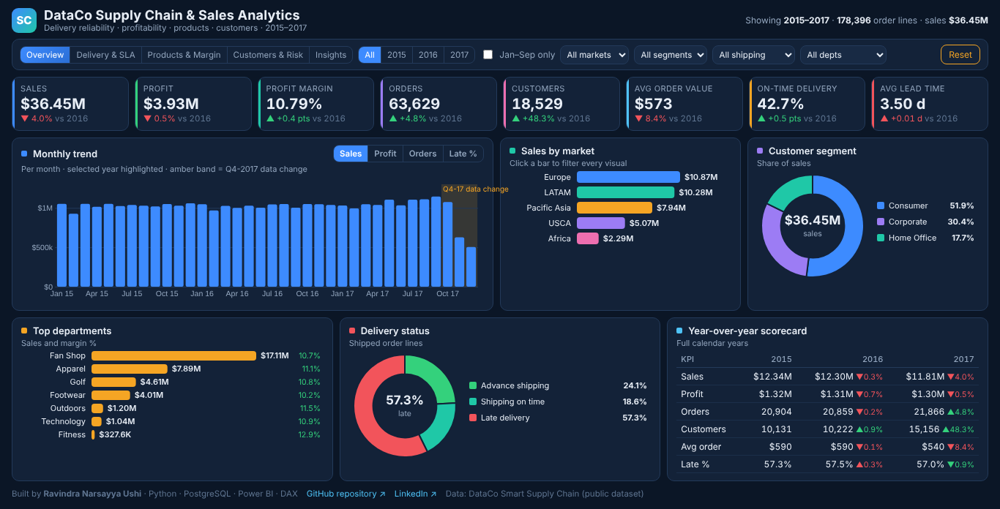
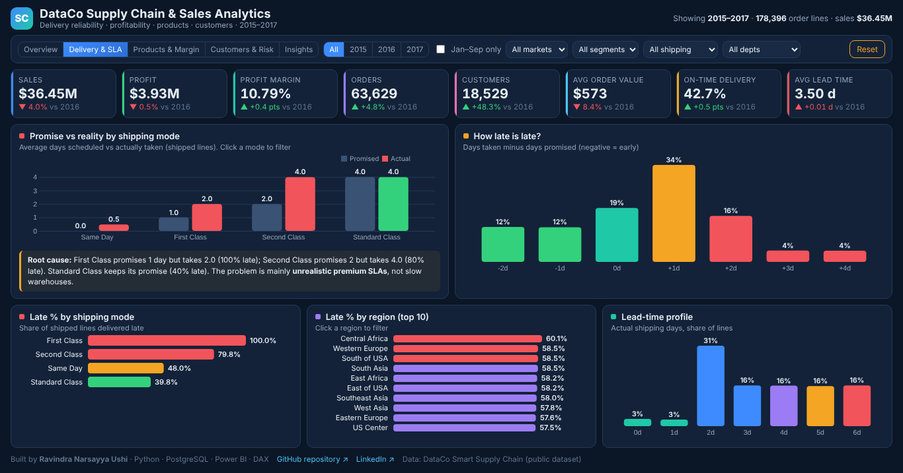
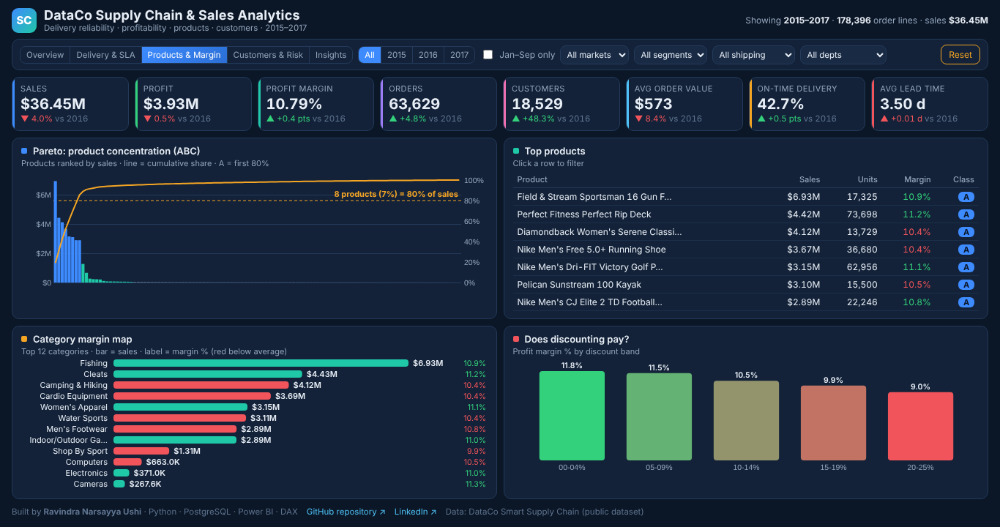
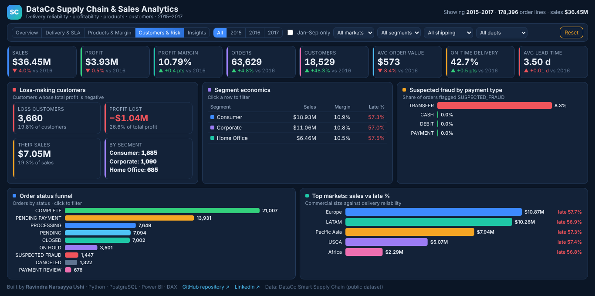
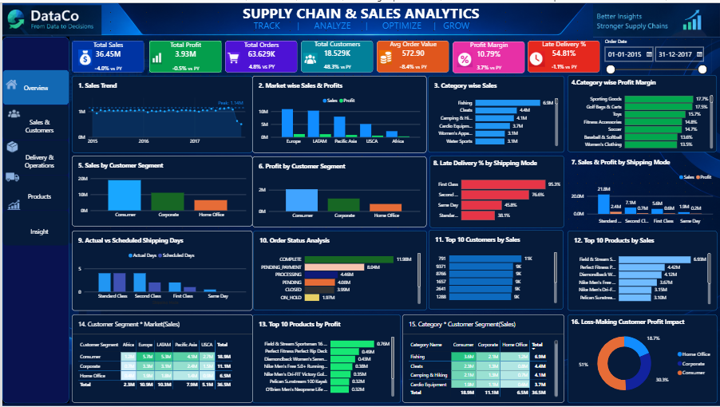
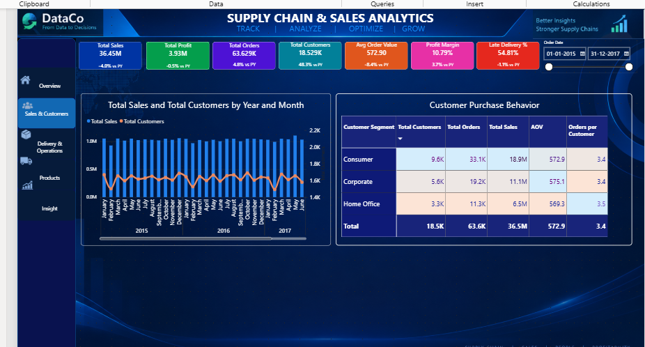
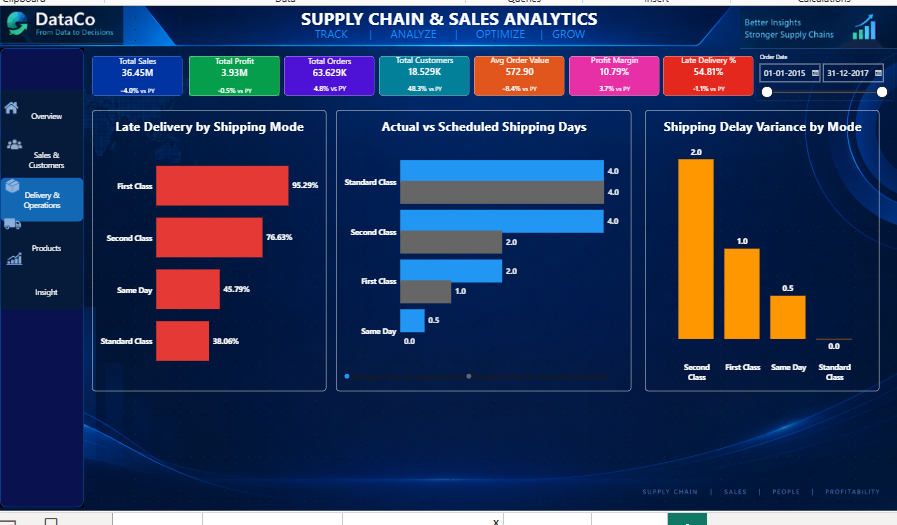
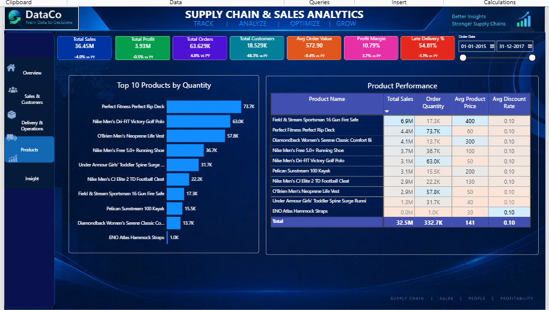
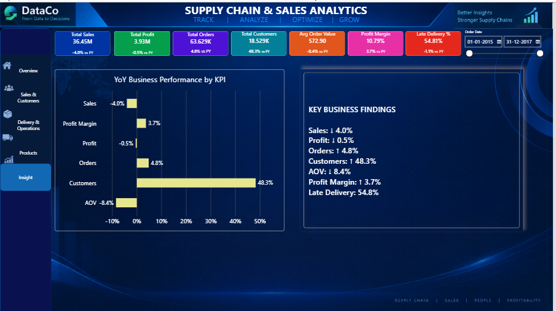

<div align="center">

# Supply Chain & Sales Analytics
### DataCo · 180,519 order lines · Python · PostgreSQL · Power BI · DAX


### [▶ Open the live interactive dashboard](https://ravindraushi14-rock.github.io/Supply-Chain-Sales-Analysis/)

[](https://ravindraushi14-rock.github.io/Supply-Chain-Sales-Analysis/)

</div>

---

## The business question

DataCo, a global sporting-goods supplier, sold **$36.45M** across 5 markets in 2015–2017, yet **57% of shipped order lines arrived late**. Management wanted to know:

- **Delivery:** why is late delivery so high, and is it a warehouse problem or a promise problem?
- **Growth:** why did 2017 sales fall 4% while customers grew 48%?
- **Profit:** which products, customers and discounts drive or destroy margin?
- **Risk:** where do suspected fraud and loss-making customers sit?

## Headline findings

| # | Finding | Evidence | Action |
| --- | --- | --- | --- |
| 1 | **Late delivery is a promise problem, not a warehouse problem** | First Class promises 1 day and always takes 2 (**100% late**). Second Class promises 2 and takes 4 (**80% late**). Standard Class meets its 4-day promise | Reset premium SLAs to real capability (2 and 4 days). This removes most "late" flags at zero operating cost |
| 2 | **2017 did not shrink like-for-like** | Full-year sales −4.0%, but **Jan–Sep 2017 vs 2016 = +4.7%** (profit +8.0%). From Oct 2017 the data changes shape: 1 item per order, new customers only | Report like-for-like growth and investigate the Q4-2017 change |
| 3 | **8 products = 80% of sales** | 118 products in total. The top 8 carry 85% of value (ABC analysis) | A-class stock policy: protect availability of the top 8 first |
| 4 | **Discounts erode margin** | Margin falls from **11.8%** (0–4% discount) to **9.0%** (20–25%) | Cap deep discounts outside A-class products |
| 5 | **Loss-making customers cost 26% of profit** | **3,660 customers** lose **$1.04M** on $7.05M sales | Review pricing and discount rules for these accounts |
| 6 | **All suspected fraud uses bank transfer** | 1,447 orders flagged, all TRANSFER (~8% of transfer orders) | Add verification for transfers above a threshold |

## Solution architecture

```mermaid
flowchart LR
    A[Raw CSV<br/>180,519 lines × 53 cols<br/>latin-1, Spanish names] --> B[Python · pandas<br/>step01 profile<br/>step02 clean + star schema]
    B --> C[(PostgreSQL<br/>supply_chain_db<br/>fact + 2 dims · 12 views)]
    C --> D[Power BI v2<br/>5 pages · 53 DAX measures]
    B --> E[step05<br/>live web dashboard<br/>GitHub Pages]
    B -. cleaning_log.csv .-> F[Audit trail]
```

| Layer | Tool | What it does |
| --- | --- | --- |
| **Clean** | Python (pandas) | 10 data issues found: 8 fixed and logged, 2 flagged. Splits one wide file into a **star schema** |
| **Store** | PostgreSQL | `fact_order_lines` (180,519) + `dim_customer` (20,652) + `dim_product` (118), with keys, foreign keys and `CHECK` constraints |
| **Analyse** | SQL | 12 KPI views (window functions, `PERCENTILE_CONT`, `FILTER`, ABC Pareto) and 15 business-question queries |
| **Visualise** | Power BI | v1: original 5-page dashboard · v2: PBIP connected to PostgreSQL, 53 measures, YoY labels in green and red |
| **Share** | HTML + d3.js | Live 5-page web dashboard with cross-filtering, YoY and a like-for-like toggle |

**One command rebuilds everything:** `python python/run_pipeline.py` (about 30 seconds).

## Data quality: what was found and fixed

| # | Issue in the raw data | Scale | Fix |
| --- | --- | ---: | --- |
| F1 | 6 columns duplicated another column exactly | 6 cols | Verified identical, then dropped |
| F2 | Masked, empty or constant columns (email, password, description, …) | 7 cols | Dropped |
| F3 | Column names with spaces and brackets | 40 cols | Renamed to snake_case |
| F4 | Extra spaces (`"Smart watch "`, `"South of  USA"`) | 24,640 cells | Trimmed |
| F5 | Two date formats in one column (`1/31/2018` and `01-31-2018`) | 71,103 rows | Parsed to real datetimes |
| F6 | Country names in Spanish (`Estados Unidos`, `Alemania`) | 164 countries | Translated with a reference table |
| F7 | Missing last name / zip code | 11 | Filled (no KPI impact) |
| F8 | No delivery or scope flags | – | Added `is_shipped`, `is_late`, `sla_gap_days`, `in_scope`, `period_flag` |
| N1 | Jan 2018 is a partial month | 2,123 lines | Flagged and excluded from the reporting scope |
| N2 | Cancelled / fraud orders counted in late % | 7,754 lines | Late % measured on **shipped** lines (57.3%, not 54.8%) |

Details: [Data quality report](docs/03_data_quality_report.md) · audit log: [`data/clean/cleaning_log.csv`](data/clean/cleaning_log.csv)

## Dashboards

### 1. Live web dashboard (v2): [open it](https://ravindraushi14-rock.github.io/Supply-Chain-Sales-Analysis/)
Five pages, click-to-filter, YoY on every KPI, and a **Jan–Sep like-for-like** toggle. It opens in any browser, with no login or software.

| Overview | Delivery & SLA |
| --- | --- |
|  |  |
| **Products & Margin** | **Customers & Risk** |
|  |  |

### 2. Power BI v2: Power BI Project on PostgreSQL
Five pages: Executive Overview, Delivery & SLA, Products & Margin, Customers & Risk and Market Detail. It has 53 DAX measures, like-for-like YTD comparisons, a field-parameter metric switch and YoY labels in green and red.
Open `powerbi/SupplyChain_Dashboard_v2.pbip` and click **Refresh** ([setup guide](powerbi/power_bi_setup.md) · [model guide](docs/05_power_bi_model.md)).

### 3. Power BI v1: original dashboard (100+ hours of design and DAX work)

| Overview | Sales & Customers | Delivery & Operations |
| --- | --- | --- |
|  |  |  |
| **Products** | **Insights** | |
|  |  | |

## How to run

**Requirements:** Python 3.10+, PostgreSQL (pgAdmin) and Power BI Desktop (the free version).

1. Download `DataCoSupplyChainDataset.csv` ([Kaggle: DataCo Smart Supply Chain](https://www.kaggle.com/datasets/shashwatwork/dataco-smart-supply-chain-for-big-data-analysis)) into `data/raw/`.
2. Run:
   ```bash
   pip install -r requirements.txt
   python python/run_pipeline.py     # asks for your PostgreSQL password once
   ```
3. Open `powerbi/SupplyChain_Dashboard_v2.pbip` (or the original `powerbi/v1/Supply Chain & Sales Analysis.pbix`), sign in to `localhost / supply_chain_db` and click **Refresh**. See the [setup guide](powerbi/power_bi_setup.md).

## Repository structure

```
├── index.html                    live web dashboard (GitHub Pages)
├── data/raw/                     raw CSV goes here (download link above)
├── data/reference/               Spanish → English country table
├── data/clean/cleaning_log.csv   audit trail of every fix
├── python/                       step01 … step05 + run_pipeline.py + web template
├── sql/                          tables · 12 KPI views · 15 business questions · legacy/ advanced queries
├── powerbi/                      v2 .pbip project · v1/ original .pbix · setup guide
├── docs/                         technical documentation (Markdown)
├── archive/reports_v1/           original project reports (Word 02–11, 30-query SQL, DAX reference)
├── screenshots/                  dashboard images
└── outputs/                      charts and CSV copies of the views
```

## Documentation

| Document | Contents |
| --- | --- |
| [01 Business requirements](docs/01_business_requirements.md) | Objectives, stakeholders, KPI definitions |
| [02 Data dictionary](docs/02_data_dictionary.md) | Raw columns, star schema and reporting view |
| [03 Data quality report](docs/03_data_quality_report.md) | Every issue, fix and validation check |
| [04 SQL guide](docs/04_sql_guide.md) | Schema design, 12 views and 15 queries with answers |
| [05 Power BI model](docs/05_power_bi_model.md) | Model, measure catalogue, YoY logic, pages |
| [06 Insights & recommendations](docs/06_insights_and_recommendations.md) | Findings, impact and an action plan |
| [Data verification report](docs/DATA_VERIFICATION_REPORT.md) | Independent re-check of every number in the original reports |

---

<div align="center">

**Ravindra Narsayya Ushi** · Operations MIS & Data Analytics · 16+ years turning operational data into decisions
[LinkedIn](https://www.linkedin.com/in/ravindra-narsayya-ushi-465762302) · [GitHub](https://github.com/ravindraushi14-rock) · [Finance Analytics project](https://github.com/ravindraushi14-rock/Finance-Analytics)

</div>
